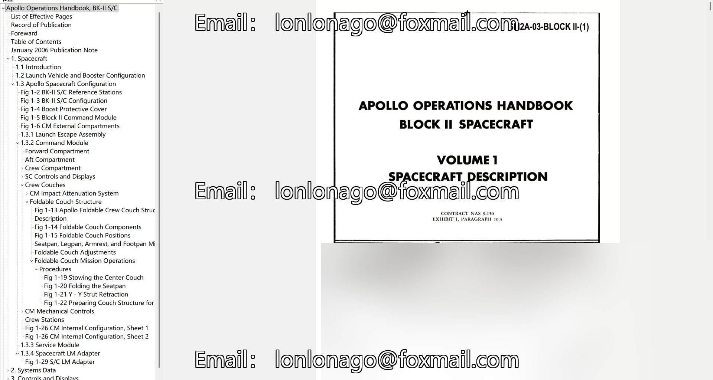
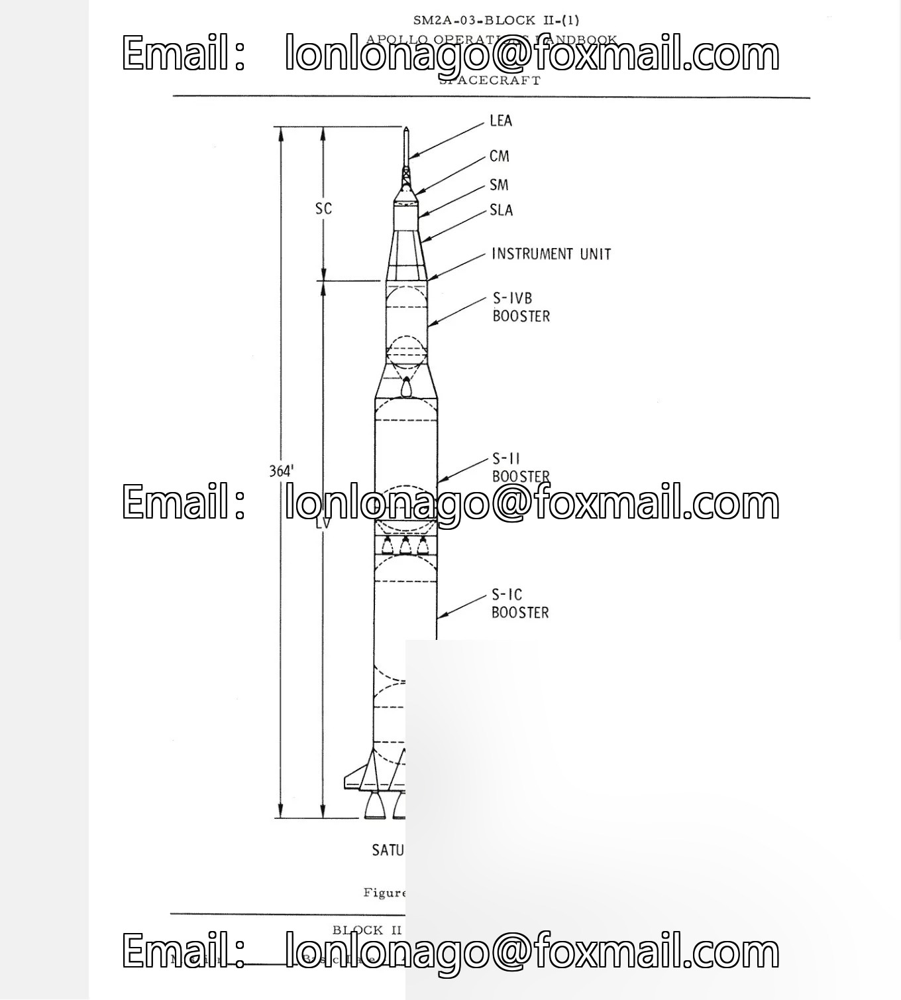
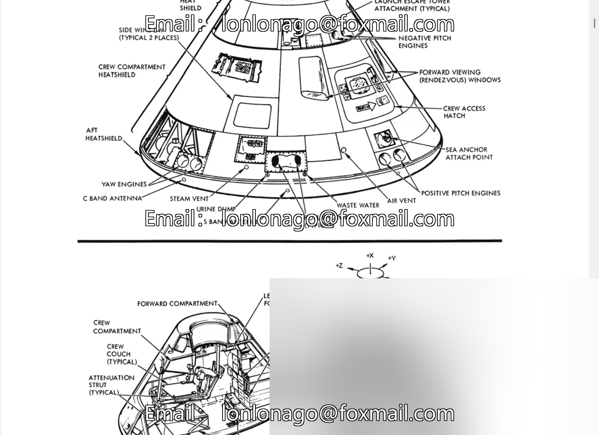
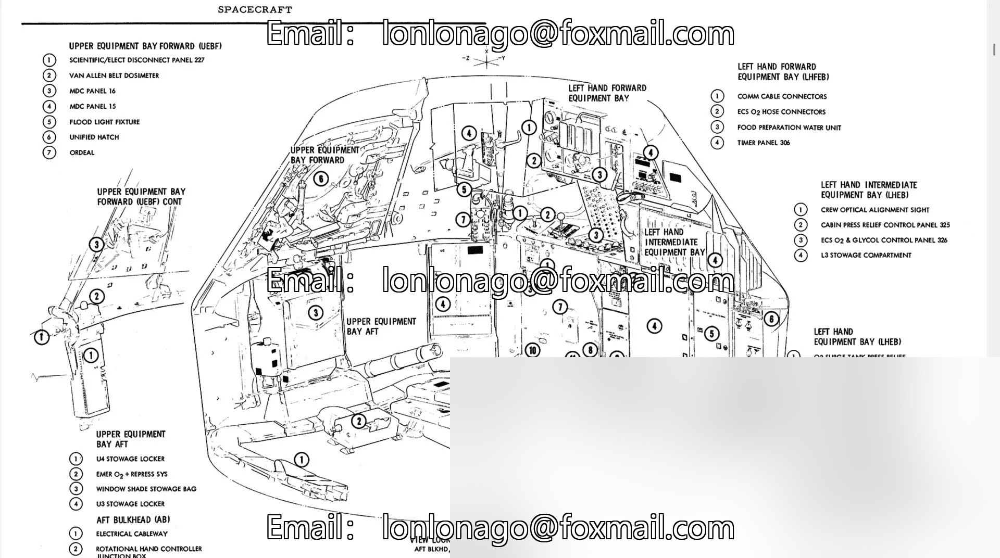
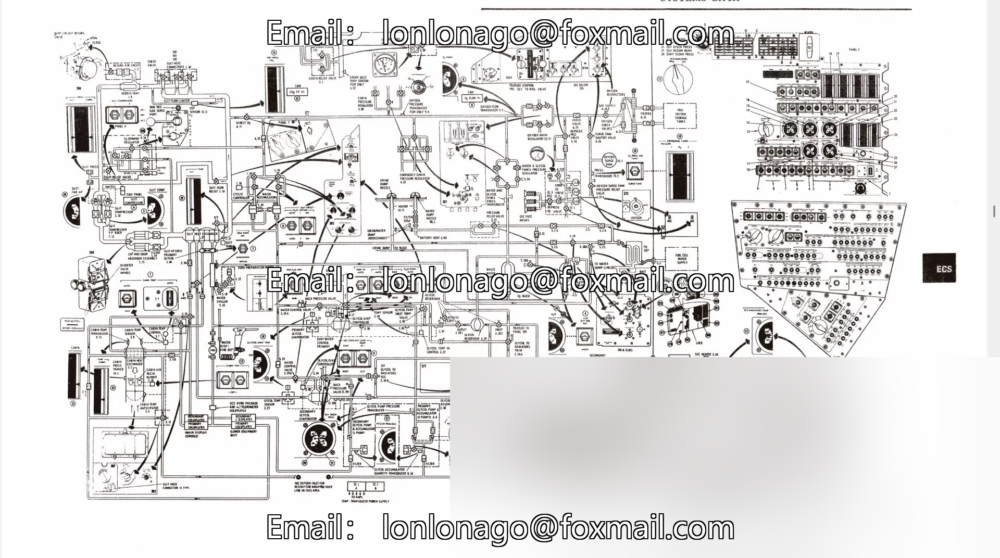

# 《APOLLO OPERATIONS HANDBOOK BL》

## Body

《APOLLO OPERATIONS HANDBOOK BLOCK II SPACECRAFT》 is approximately 900 pages.
1. Content of the materials
1. Description of the spacecraft system of Apollo Planetary Block II
2. Spacecraft configuration, structure, and system principles
3. Detailed descriptions of each module (CM, SM, LEA, SLA) of the spacecraft
4. Structure and functions of the launch system (S-IC, S-II, S-IVB)
5. Internal layout, equipment, and instrument units of the spacecraft
6. Circuit diagrams, system principle diagrams, and operation processes

2. Document characteristics
Authority: The official publication of the United States National Aeronautics and Space Administration (NASA)
Professionalism: Systematically introduce the technical details of the Apollo spacecraft
Practicality: Suitable for aerospace technology research, historical enthusiasts, and model-making references

3. Applicable groups
Space engineers, model enthusiasts, historical researchers

are copyable and non-refundable upon sale.

This document is the APOLLO OPERATIONS HANDBOOK BLOCK II SPACECRAFT, covering the Apollo Plan Block II spacecraft system, spacecraft configuration and structure, module details, launch systems, internal layout and equipment, and circuit diagrams; it is reprintable for sale.

<!-- AI_ENRICHED -->

## Images

## Payment

Here is a pay link on Stripe ( https://buy.stripe.com/3cs8yP7sY87d0vu9AB ). Please contact me lonlonago@foxmail.com after funding $89, and I will send you a complete data files , thank you!

